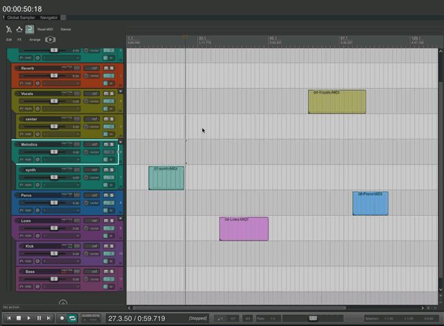

# ReaBackground

A muted video (synced to REAPER's play and edit cursor) or a still image behind the arrange view, on macOS.



Items, the grid, cursors and markers stay on top. The time selection, mute shading and grid lines are drawn as shading over the video instead of hiding it, and the background opacity, shading and grid strength are adjustable.

## Requirements

- macOS 11 or newer (Apple silicon or Intel)
- REAPER with Metal rendering enabled (the default; Preferences > General > Advanced UI/system tweaks)
- [ReaImGui](https://forum.cockos.com/showthread.php?t=250419) for the settings window, installed from ReaPack

Windows and Linux are not supported: the extension works by hooking REAPER's Metal drawing on macOS.

## Install

With [ReaPack](https://reapack.com):

1. Extensions > ReaPack > Import repositories... and paste
   `https://github.com/aurnik/ReaScripts/raw/main/index.xml`
2. Extensions > ReaPack > Browse packages..., install **ReaBackground**, then restart REAPER.

That repository carries all of aurnik's REAPER packages, so importing it once also brings their updates.

Manually: download `reaper_reabackground.dylib` from the latest release into `UserPlugins/` inside the REAPER resource folder (Options > Show REAPER resource path...), copy `ReaBackground.lua` anywhere under `Scripts/`, restart REAPER, and load the script with Actions > Show action list > New action > Load ReaScript. If macOS refuses to load a dylib downloaded with a browser, clear its quarantine flag:

```sh
xattr -d com.apple.quarantine ~/Library/Application\ Support/REAPER/UserPlugins/reaper_reabackground.dylib
```

## Use

Run the action **ReaBackground.lua** (or Extensions > ReaBackground...). Running it again while it is active reopens the window.

- The **+** tile imports a video (re-encoded to 1280x720 H.264, optionally trimmed) or an image into `Data/ReaBackground/` in the REAPER resource folder.
- Click a thumbnail to use it in the current project. The globe icon makes it the default for every project without a choice of its own.
- The preview shows which part of the picture survives the aspect-fill crop at the arrange's current size; drag it to choose the part that shows. Below it, set the range of the video that plays from project time zero and whether it loops.
- Sliders: **background** is the video's opacity over the track background colour, **shading** the strength of the time selection and mute overlays over the video, **grid** the grid line opacity.
- **Start with REAPER** runs the background on launch without opening the window. The switch on the right turns the background off and restores the theme colours.

Hold Alt with the window focused to see sync and keying diagnostics in the footer.

## How it works

REAPER on macOS paints the arrange view into a Metal texture owned by swell. The extension makes that view's layer non-opaque, sets the theme's empty-track-area colours to one key colour, and intercepts every write to the texture so pixels of the key colour become transparent before they are presented. A layer-hosting view with an AVPlayerLayer (or an image layer) sits behind the arrange and shows through. Colours REAPER produces by blending its translucent overlays over the key are predicted with REAPER's own LICE blending and mapped to semi-transparent shading.

The Lua script owns the state (library, per-project choice, settings) and drives the extension through its `AUBG_*` ReaScript API; the settings window is ReaImGui.

This depends on swell internals (the `m_metal_texture` and `m_use_metal` ivars and the `swellDrawMetal:` selector). If a REAPER update changes them, the script reports that enabling failed and the arrange is left untouched.

## Build

```sh
native/build.sh
```

Builds a universal `reaper_reabackground.dylib` with the system clang and copies it into `UserPlugins/` when a REAPER resource folder exists. The handful of SDK and swell headers it needs are vendored in `native/vendor/`; set `VENDOR_SRC` to a directory containing `reaper-sdk/` and `WDL/` checkouts to refresh them.

## Release

This repository holds the source; the ReaPack package file lives in [aurnik/ReaScripts](https://github.com/aurnik/ReaScripts) as `Extensions/ReaBackground.ext`, and its `@provides` URLs point at a tagged release here.

1. Build, commit, tag `v<version>` and push the tag.
2. Create a GitHub release for the tag with `native/reaper_reabackground.dylib` attached.
3. In aurnik/ReaScripts, bump `@version` and add a `@changelog` line in the package file, then run `reapack-index --commit` and push.

## License

MIT. The vendored REAPER SDK and WDL swell headers are by Cockos and carry their own permissive licence.
